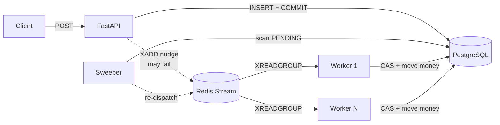
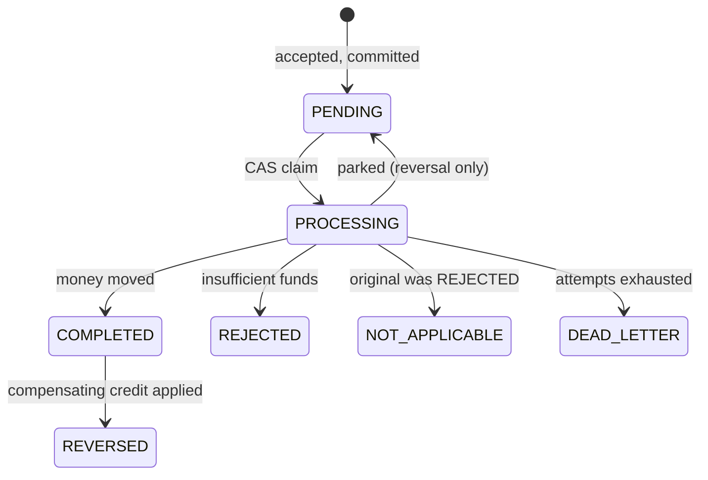

# Design: Reliable Transaction Processing Service

*Design record. Written 2026-09-21, before implementation; last updated 2026-09-27.*

> **What this document is.** The design, argued on paper before any code was written — and
> deliberately left in the future tense where it was written that way, because the value of a
> design document is partly the record of what was decided *in advance* of the evidence.
>
> It is not the operating manual. [`../README.md`](../README.md) is that: how to run the stack,
> the tests, the failure demonstrations and the load test, plus the measured results.
>
> Two entries in the **Decision log** were added after implementation, because measurement found
> what testing had not: **D10** (an opening balance must be a ledger event, found by a metric
> reading `txnsvc_balance_mismatches = 7`) and **D11** (sweeper backpressure must be measured from
> queue depth, never from `XLEN` — a load test exposed a correctness bug that the correctness tests
> could not). Both are recorded with the wrong reasoning that produced them, not just the fix.


## Purpose and scope

This document specifies the service before it is implemented, so the design can be argued with on paper rather than discovered to be wrong in code. Every significant decision is recorded with the alternatives that were rejected and the reason.

The problem is correctness and reliability, not CRUD. The API is seven endpoints that would take an afternoon to build. The difficulty lives entirely in what happens when requests are duplicated, workers die mid-operation, messages are redelivered, events arrive out of order, and infrastructure disappears and returns.

The design is therefore organised around **invariants** — statements that must remain true no matter what fails — rather than around features.

**In scope.** Durable acceptance of transaction requests. Asynchronous processing by multiple independent workers. Exactly-once financial effect under duplicate submission and duplicate delivery. Correct behaviour under worker crashes. Out-of-order arrival of reversals. Graceful degradation when Redis or PostgreSQL is unavailable.

**Out of scope, deliberately.** Authentication and authorisation. Currency conversion. Inter-account transfers. Interest and fee calculation. Account lifecycle management. Any frontend. Where one of these touches a decision, it is noted at that point.

## Invariants

Six statements. Every mechanism in this design exists to hold one of them, and any change to the system is judged by whether these still hold.

| # | Invariant | Source | Enforced by |
| --- | --- | --- | --- |
| I1 | A logical transaction's financial effect occurs exactly once, however many times it is submitted or delivered | §5 | `UNIQUE(transaction_id)` at accept; CAS on `status` at apply |
| I2 | Concurrent debits never lose an update and never drive a balance below zero | §6 | row lock on `accounts`; `WHERE balance >= amount`; `CHECK (balance >= 0)` |
| I3 | A `202` response means the request is durably stored and will eventually be processed | §10 | the PostgreSQL commit *is* the acceptance; nothing is promised before it |
| I4 | A worker may die at any instant without duplicating or losing a financial effect | §7 | claim, money movement and finalisation in one database transaction; queue ack strictly after commit |
| I5 | Originals and reversals converge to the correct net effect regardless of arrival order or duplication | §8 | derived `REV-` identity; compensating entries; park-and-retry |
| I6 | No monetary value is ever represented in binary floating point | §9 | `NUMERIC(20,4)` in PostgreSQL, `Decimal` in Python, strings on the wire |

Two of these are worth stating in their negative form, because that is how they are usually violated.

**I1 is not "exactly-once delivery."** Exactly-once delivery is impossible across a network. The guarantee is exactly-once *effect* under at-least-once delivery, which is achievable and is a different engineering problem.

**I3 is a promise, not a status code.** Returning `202` and then losing the request is the worst available failure, because nobody learns anything is wrong. A `500` is preferable to a false `202` in every case.

## Failure model

The design assumes every component fails, at the worst possible instant, repeatedly. What follows is what each failure does and what the system still guarantees.

| What fails | When it matters most | Behaviour | Guarantee preserved |
| --- | --- | --- | --- |
| API process dies mid-request | after the `INSERT`, before the response | client sees a connection error and retries; the retry hits `UNIQUE(transaction_id)` and returns the existing state | I1, I3 |
| PostgreSQL unavailable | during accept | `POST` returns `503`; no `202` is issued | I3 |
| PostgreSQL unavailable | during apply | the worker's transaction never commits; the entry stays in the queue's pending list and is redelivered | I4 |
| Redis unavailable | during accept | the commit already happened, so the `202` stands; the nudge fails silently and the sweeper dispatches the row when Redis returns | I3 |
| Redis loses recent entries | any time | rows still sit in PostgreSQL as `PENDING`; the sweeper re-dispatches them | I3 |
| Worker killed after commit, before ack | §7's explicit case | the entry remains pending; another worker claims it; the CAS matches zero rows; no second effect | I1, I4 |
| Worker killed mid-transaction | any time | PostgreSQL rolls back claim and money movement together; nothing partial survives | I4 |
| Same message delivered to two workers | sweeper races the nudge | both attempt the CAS; the row lock serialises them; exactly one matches | I1 |
| Reversal arrives before its original | §8 | the reversal parks as `PENDING` and retries until the original completes | I5 |
| Original never arrives | pathological | the reversal exhausts its attempt budget and moves to `DEAD_LETTER`, visible in `/metrics` | I5 |

### The dual-write problem, stated once

No two independent systems can be written atomically. Between the PostgreSQL commit and the Redis `XADD` there is always an instant where the process can die.

That gap is not fixed, it is **chosen**. The design fails on the side of *accepted but not yet dispatched*, because that state is recoverable by scanning PostgreSQL. The opposite ordering — dispatch first, commit second — produces work for records that do not exist, which is not recoverable.

The sweeper exists solely to close that chosen gap. It is also, unavoidably, a source of duplicate deliveries, which is why I1's apply-time guard is mandatory rather than defensive.

## Architecture overview

Four components. PostgreSQL is the system of record; everything else is machinery around it.



Solid arrows are correctness paths. Dotted arrows are allowed to fail without violating any invariant.

### The durable-accept boundary

The single most important line in the system runs through the API's `COMMIT`. Before it, nothing is promised and any failure is the client's to retry. After it, the work will happen even if every process dies.

This is the **transactional outbox** pattern. Its defining property is that the queue is not the record — the database is, and the queue is a latency optimisation over work that is already durable.

Redis decides *when* a worker is woken. It never decides *whether* work happens. Every correctness question is answered inside a PostgreSQL transaction, which is why Redis can be stopped, restarted or emptied without risk to any invariant.

### Why each component exists

| Component | Job | What it must never do |
| --- | --- | --- |
| FastAPI | validate, write, commit, answer fast | decide anything that requires balance state |
| PostgreSQL | hold the truth; arbitrate every race | be bypassed by application-level checking |
| Redis Streams | carry pointers to work; make redelivery visible | be trusted as a durable store |
| Workers (N) | move money inside one transaction | hold state in memory across messages |
| Sweeper | re-dispatch work the nudge failed to deliver | move money itself |

## Data model

Three tables. Reversals live in `transactions` alongside originals rather than in a table of their own, so that one CAS pattern, one state machine and one endpoint serve both.

```sql
CREATE TABLE currencies (
    code        CHAR(3) PRIMARY KEY CHECK (code ~ '^[A-Z]{3}$'),
    minor_units SMALLINT NOT NULL CHECK (minor_units BETWEEN 0 AND 4)
);

CREATE TABLE accounts (
    id         BIGSERIAL PRIMARY KEY,
    currency   CHAR(3) NOT NULL REFERENCES currencies(code),
    balance    NUMERIC(20,4) NOT NULL DEFAULT 0 CHECK (balance >= 0),
    created_at TIMESTAMPTZ NOT NULL DEFAULT now(),
    updated_at TIMESTAMPTZ NOT NULL DEFAULT now()
);

CREATE TYPE tx_kind   AS ENUM ('TRANSACTION', 'REVERSAL');
CREATE TYPE tx_type   AS ENUM ('DEBIT', 'CREDIT');
CREATE TYPE tx_status AS ENUM ('PENDING', 'PROCESSING', 'COMPLETED',
                               'REJECTED', 'REVERSED',
                               'NOT_APPLICABLE', 'DEAD_LETTER');

CREATE TABLE transactions (
    transaction_id  TEXT PRIMARY KEY,
    kind            tx_kind NOT NULL DEFAULT 'TRANSACTION',
    reverses_id     TEXT,                              -- no FK; see below
    type            tx_type NOT NULL,
    status          tx_status NOT NULL DEFAULT 'PENDING',

    -- NULL on a parked reversal; filled when it applies
    account_id      BIGINT REFERENCES accounts(id),
    amount          NUMERIC(20,4) CHECK (amount > 0),
    currency        CHAR(3) REFERENCES currencies(code),
    device_id       TEXT,
    client_ts       TIMESTAMPTZ,

    failed_attempts INT NOT NULL DEFAULT 0,
    next_attempt_at TIMESTAMPTZ NOT NULL DEFAULT now(),
    parked_since    TIMESTAMPTZ,
    last_error      TEXT,
    accepted_at     TIMESTAMPTZ NOT NULL DEFAULT now(),
    processed_at    TIMESTAMPTZ,

    CONSTRAINT original_is_complete CHECK (
        kind = 'REVERSAL'
        OR (account_id IS NOT NULL AND amount    IS NOT NULL
        AND currency   IS NOT NULL AND device_id IS NOT NULL
        AND client_ts  IS NOT NULL)),

    CONSTRAINT settled_is_complete CHECK (
        status NOT IN ('COMPLETED', 'REVERSED')
        OR (account_id IS NOT NULL AND amount IS NOT NULL
        AND currency   IS NOT NULL)),

    CONSTRAINT reversal_has_target CHECK (
        (reverses_id IS NOT NULL) = (kind = 'REVERSAL')),

    CONSTRAINT reversal_only_credits CHECK (
        kind = 'TRANSACTION' OR type = 'CREDIT')
);
```

### Why a reversal row is thin, and why `reverses_id` has no foreign key

A reversal that arrives before its original cannot name an account or an amount — `POST /transactions/{id}/reverse` carries no body, and the original does not exist to copy from. A foreign key on `reverses_id` would reject the insert outright, and `NOT NULL` on `account_id` or `amount` would too. §8's first message would fail at the front door.

So a reversal has no money of its own. Its amount *is* the original's amount and its account *is* the original's account; both are inherited when it applies, not asserted when it is accepted.

The two completeness constraints keep this safe. `original_is_complete` means an ordinary transaction is never thin. `settled_is_complete` means nothing can reach `COMPLETED` or `REVERSED` without knowing what it settled. Referential integrity for `reverses_id` comes from the state machine instead: nothing can be marked `REVERSED` without a CAS finding a real `COMPLETED` row.

### Money: `NUMERIC(20,4)` and `Decimal`

Binary floating point cannot represent `0.1`, so error accumulates. Subtracting `0.1` from `10000.0` a thousand times in Python yields `9899.999999999636`. The same loop in `Decimal` yields exactly `9900.00`.

`NUMERIC` stores base-10 digits and does exact decimal arithmetic. `REAL` and `DOUBLE PRECISION` are the same disease made durable. PostgreSQL's `MONEY` type is rejected because its output format depends on the server's `lc_monetary` locale and its scale is fixed at database configuration time.

Scale 4 rather than 2 gives headroom for three-decimal currencies — KWD, BHD, OMR — at no cost. The currency's real scale is enforced at the API boundary against `currencies.minor_units`.

The system only adds and subtracts amounts that arrived already valid. There is no multiplication or division anywhere, so no rounding policy is needed and none is defined.

### Direction lives in `type`, never in the sign

Amounts are always positive; `type` carries the direction. Signed amounts would let a `DEBIT` of `-250.75` act as a credit, would make `CHECK (amount > 0)` impossible, and would force every aggregate query to know the sign convention to be correct.

### Currency is copied onto the transaction

Deliberate denormalisation. If an account's currency were ever corrected, historical transactions must still record what they actually were. A ledger states what happened, not what current configuration implies happened.

A mismatch between a request's currency and the account's is a `422` at validation. That decision needs the account's *currency*, not its *balance*, so it belongs in the synchronous path. Implicit conversion is never performed — not with a hardcoded rate, not with a fetched one.

### Row lifecycle: what gets a row

One row per **logical operation**, with `status` mutated in place. A reversal is a separate logical operation, so it gets its own row. State transitions do not get rows.

| Scenario | Rows | Final statuses |
| --- | --- | --- |
| Debit declined for insufficient funds | 1 | `TX-200` → `REJECTED` |
| Debit completed, later reversed | 2 | `TX-100` → `REVERSED`, `REV-TX-100` → `COMPLETED` |
| Reversal arriving before its original | 2 | identical to the row above |

The last line is the point of §8: the final row-set is independent of arrival order, and can be asserted directly in a test.

**Financial history is append-only.** Every movement of money has its own permanent row. Nothing that moved money is deleted or merged.

**Processing history is not retained.** The path through `PENDING → PROCESSING → COMPLETED → REVERSED` is overwritten at each step. What survives is `accepted_at`, `processed_at`, `attempts` and `last_error` — four breadcrumbs, not a trail.

### Reconciliation

Because every movement is its own row, the balance is reconstructible:

```sql
SELECT COALESCE(SUM(
         CASE WHEN type = 'CREDIT' THEN amount ELSE -amount END
       ), 0)
  FROM transactions
 WHERE account_id = $1
   AND status IN ('COMPLETED', 'REVERSED');
```

`COMPLETED` and `REVERSED` both count, because both mean the money moved — `REVERSED` says a compensating row exists elsewhere, not that the original never happened.

This must always equal `accounts.balance`. It is asserted after every concurrency test and exposed as a `/metrics` gauge counting mismatched accounts. A divergence means the apply path is broken, and it surfaces immediately rather than at audit.

## Constraints and indexes

Every constraint here is load-bearing. The guiding rule is that a rule the database enforces cannot be bypassed by a code path that forgot about it.

| Constraint | Prevents | Invariant |
| --- | --- | --- |
| `transactions.transaction_id` PRIMARY KEY | duplicate submission creating a second row | I1 |
| `accounts.balance CHECK (>= 0)` | negative money, even if application logic fails | I2 |
| `transactions.amount CHECK (> 0)` | sign smuggling; keeps direction in `type` | I6 |
| `accounts.currency` FK → `currencies` | unknown or mistyped currency codes | — |
| `transactions.account_id` FK → `accounts` | transactions against accounts that do not exist | — |
| `original_is_complete` | an ordinary transaction accepted without an account or amount | I3 |
| `settled_is_complete` | any row reaching `COMPLETED` or `REVERSED` without knowing what it settled | I1, I5 |
| `reversal_has_target` | a reversal with no target, or an original carrying one | I5 |
| `reversal_only_credits` | a reversal that debits rather than compensates | I5 |

### Indexes

```sql
-- Makes available-balance a few page reads instead of a table scan.
CREATE INDEX idx_tx_pending_debits_by_account
    ON transactions (account_id)
 INCLUDE (amount)
   WHERE status = 'PENDING' AND type = 'DEBIT';

-- The sweeper's scan: work that is due, in due order.
CREATE INDEX idx_tx_due
    ON transactions (next_attempt_at)
   WHERE status = 'PENDING';

-- GET /accounts/{id}/transactions, newest first.
CREATE INDEX idx_tx_by_account_time
    ON transactions (account_id, accepted_at DESC);

-- Finding a parked reversal by its target.
CREATE INDEX idx_tx_reversals_by_target
    ON transactions (reverses_id)
   WHERE kind = 'REVERSAL' AND status = 'PENDING';
```

**Why the first two are partial.** `PENDING` rows are a small, constantly draining slice — a few thousand at most, even when `transactions` holds tens of millions. A partial index covers only rows matching its `WHERE` clause, so it stays small enough to remain resident in memory, and it does not grow with history.

The `INCLUDE (amount)` on the first index makes it an index-only scan: PostgreSQL sums the pending amounts without visiting the table at all.

This matters more than it looks. Without `idx_tx_pending_debits_by_account`, the available-balance query is a sequential scan and the service collapses under the load test. With it, the query is near-free. The same design is excellent or unusable depending on one index.

## Transaction state machine

One `status` column governs both kinds of row. Every CAS statement in the system names specific values from this machine, so the set of states and the legal transitions are part of the interface, not an implementation detail.



| State | Meaning | Terminal |
| --- | --- | --- |
| `PENDING` | durably accepted, not yet applied | no |
| `PROCESSING` | claimed by a worker inside an open transaction | no |
| `COMPLETED` | the financial effect has occurred | no — a reversal may follow |
| `REJECTED` | could not be applied; insufficient funds | yes |
| `REVERSED` | was completed, then compensated | yes |
| `NOT_APPLICABLE` | a reversal whose original was rejected; nothing to give back | yes |
| `DEAD_LETTER` | attempts exhausted; requires human attention | yes |

### Three rules

**`REVERSED` is reachable only from `COMPLETED`.** A reversal never touches a `PENDING` original — it parks instead. This makes the invariant trivially checkable: money can only be returned if it was taken.

**A reversal of a `REJECTED` original terminates immediately as `NOT_APPLICABLE`.** Easy to miss. Miss it and the reversal parks forever, burns its retry budget and dead-letters, which looks like a defect during review. Nothing moved, so there is nothing to give back.

**A reversal cannot itself be reversed.** `POST /transactions/REV-TX-100/reverse` returns `400`. Otherwise the system produces `REV-REV-TX-100` and an infinite regress with real money in it.

### A note on `PROCESSING`

Because claim, money movement and finalisation all occur inside one database transaction, `PROCESSING` is written and replaced before any commit. No other session ever observes it. It is retained because it makes the worker's intent explicit in the SQL, and because splitting claim from apply later would make it visible without a schema change.

### Retry policy

Three situations reach the worker again, and they are bounded by different things. Counting them with one counter is the common mistake: a reversal parked for ten seconds at a 250 ms interval burns 40 attempts and dead-letters a perfectly healthy row.

| Situation | Is it a failure? | Bound | Column |
| --- | --- | --- | --- |
| Reversal parked, original not yet arrived | no — expected | 24 hours elapsed | `parked_since` |
| Transient error (connection lost, deadlock, serialisation failure) | yes, recoverable | 10 attempts with exponential backoff | `failed_attempts`, `next_attempt_at` |
| Permanent error (constraint violation, malformed row) | yes, unrecoverable | none — `DEAD_LETTER` on the first attempt | `last_error` |

**Parking increments nothing.** It is bounded by time, because "how long has the original been missing" is the real question. A parked reversal sets `parked_since` once and `next_attempt_at` on each pass.

**Permanent errors do not retry.** If PostgreSQL rejected the row on a `CHECK`, it will reject it identically forever. Retrying only delays the alert.

**Transient errors back off exponentially** — 1, 2, 4 … 512 seconds. Ten attempts therefore span about **seventeen minutes**, not ten seconds. A PostgreSQL outage longer than that is an incident, and dead-lettering with a metric is the correct response: someone needs to know.

That last point dissolves the apparent choice between capping by count and capping by time. With exponential backoff **an attempt cap is a time cap**. Choose the horizon you want, derive the count from the backoff schedule, and record the derivation.

## Accept path

`POST /transactions` does as little as possible. It never reads a balance and never decides an outcome.

1. Validate the payload. Well-formedness, amount positive, scale within the currency's `minor_units`, account exists, currency matches the account.
2. `BEGIN`.
3. `INSERT INTO transactions (...) ON CONFLICT (transaction_id) DO NOTHING`.
4. `COMMIT`. **This commit is the acceptance.**
5. Best-effort `XADD` to the Redis stream. Failure here is logged and ignored.
6. Return `202 Accepted` with the transaction's current state.

### Why `ON CONFLICT` and not a prior `SELECT`

A check followed by an insert has a gap between them, and a thousand concurrent requests live in that gap:

```html
Request A                          Request B
SELECT ... WHERE id = 'TX-938283'
  -> 0 rows, looks new
                                   SELECT ... WHERE id = 'TX-938283'
                                     -> 0 rows, looks new
INSERT ...                  OK
                                   INSERT ...                  OK
                          -> two rows. Money moves twice.
```

No amount of careful Python closes that gap, because the two requests run in different processes on different machines. A `threading.Lock` does not exist across containers.

`INSERT ... ON CONFLICT` removes the gap by making the check and the write the same operation. PostgreSQL locks the index entry; the second insert waits for the first to commit, then matches nothing. The guarantee comes from the storage engine, which is what §5 requires.

### Duplicate submissions

A conflict is not an error. The endpoint returns `200 OK` with the existing transaction's state, so a retrying client converges on the truth rather than receiving a failure it will retry again.

Of 1,000 concurrent identical submissions, one creates a row and enqueues one message. The other 999 read the existing row. The queue never sees them.

### Reversals

`POST /transactions/{transaction_id}/reverse` writes a row with `kind = 'REVERSAL'`, `type = 'CREDIT'` and the derived identity `REV-{transaction_id}`.

The identity must be **derived, never minted**. A fresh UUID per call would make each retry a new reversal, and duplicate reversal requests would double-credit the account. The derived key means duplicate reversals collapse against the same primary key as everything else.

### When PostgreSQL is unreachable

The commit fails, so nothing was accepted. The API returns `503 Service Unavailable` with `Retry-After`. No `202` is issued, which is exactly what §10 demands: the system does not report durable acceptance for work it has not durably stored.

## Apply path

The worker's critical section. Claim, money movement and finalisation occur in **one** database transaction; the queue acknowledgement occurs strictly after the commit returns.

```sql
BEGIN;

-- 1. CLAIM. This is the idempotency guard.
UPDATE transactions
   SET status = 'PROCESSING'
 WHERE transaction_id = $1
   AND status = 'PENDING'
RETURNING account_id, type, amount;
--  0 rows -> already claimed or already done.
--           COMMIT, acknowledge, walk away.

-- 2. MOVE THE MONEY. Same transaction.
UPDATE accounts
   SET balance = balance - $amount, updated_at = now()
 WHERE id = $account_id
   AND balance >= $amount
RETURNING balance;
--  0 rows -> insufficient funds.

-- 3. FINALISE.
UPDATE transactions
   SET status = 'COMPLETED' | 'REJECTED', processed_at = now()
 WHERE transaction_id = $1;

COMMIT;
```

### Why the CAS is the guarantee

Reading the status into Python and then deciding reintroduces the check-then-act race in new clothing: two workers both read `PENDING` before either writes. The conditional `UPDATE` makes the check and the write one statement.

When two workers race it, PostgreSQL locks the row, makes the loser wait for the winner to commit, then re-evaluates the loser's `WHERE` clause against the committed row. It matches nothing. Zero rows returned is the signal that someone else has the work.

### Why atomicity makes crash-safety free

If the worker is killed between steps 1 and 3 — `kill -9`, container evicted, power lost — PostgreSQL rolls back the claim and the balance change together. There is no half-applied state to reconcile, ever.

Either the transaction committed, and a redelivery finds `COMPLETED` and does nothing, or it did not, and a redelivery does the work properly. There is no third case.

### Acknowledge last, always

The queue acknowledgement is deliberately outside and after the commit. If the ack is lost, the entry is redelivered and the redelivery is harmless. The reverse ordering — ack first, commit second — loses work silently, which violates I3.

### Insufficient funds

Step 2 returning zero rows means the funds were not there. The transaction is finalised as `REJECTED` and **committed** — not rolled back. Rolling back would return the row to `PENDING`, and it would be retried forever against an account that will never have the money.

`CHECK (balance >= 0)` on the table is the backstop. If any future code path gets this wrong, PostgreSQL refuses the write rather than quietly creating negative money.

### Why §6 needs nothing further

The row lock PostgreSQL takes on `accounts` during step 2 serialises concurrent debits automatically. One hundred simultaneous debits against one account queue on that lock, apply one at a time, and the `WHERE balance >= $amount` clause rejects the first one that cannot be funded. No application-level locking is involved, which is what §6 means by remaining correct across independent processes.

## Reversals and out-of-order convergence

A reversal is a first-class transaction that produces a compensating credit. It is not a flag on the original and not a deletion.

Its claim on the original is the same CAS pattern pointed at a different value:

```sql
UPDATE transactions
   SET status = 'REVERSED'
 WHERE transaction_id = $original
   AND status = 'COMPLETED'
RETURNING account_id, amount;
```

That one statement answers two questions atomically: *has the original landed?* and *have I already reversed it?* Zero rows means one of the two, and both mean the same action — do not credit.

### Park and retry

Zero rows because the original has not completed yet is not a failure. The reversal sets itself back to `PENDING`, records `parked_since` and a fresh `next_attempt_at`, commits and acknowledges. It increments no failure counter — parking is not an error, and counting it as one would dead-letter healthy reversals within seconds. It is now indistinguishable from any other accepted-but-unprocessed row, which means the sweeper already handles it.

No new mechanism is introduced for §8. The safety net built for §10 does double duty as the retry loop for out-of-order events.

Parked reversals use a shorter sweeper interval than ordinary stragglers — 250 ms rather than 5 s — because the original is usually milliseconds away.

### The five-message trace

The requirement's arrival order, against account 981 holding SAR 1,000, where `TX-100` is a DEBIT of SAR 250.75. Required net effect: 0.

At the front door, five arrivals collapse to two rows:

| # | Arrival | Front door | Rows | Queue |
| --- | --- | --- | --- | --- |
| 1 | REVERSAL TX-100 | insert `REV-TX-100`, PENDING | 1 | 1 |
| 2 | DEBIT TX-100 | insert `TX-100`, PENDING | 2 | 2 |
| 3 | DEBIT TX-100 | conflict, return existing | 2 | 2 |
| 4 | REVERSAL TX-100 | conflict, return existing | 2 | 2 |
| 5 | DEBIT TX-100 | conflict, return existing | 2 | 2 |

Three of the five are eliminated before any money logic runs, by the primary key alone. Ordering is the only remaining problem, and it involves two operations rather than five.

Then the workers:

| Step | Action | Balance |
| --- | --- | --- |
| 1 | `REV-TX-100` claims; CAS on `TX-100 AND status='COMPLETED'` matches 0 rows; parks | 1,000.00 |
| 2 | `TX-100` claims; debits 250.75; `COMPLETED` | 749.25 |
| 3 | sweeper re-dispatches `REV-TX-100` | 749.25 |
| 4 | `REV-TX-100` claims; CAS matches; credits 250.75; `TX-100` → `REVERSED` | **1,000.00** |

Net effect 0, with both movements recorded. The design converges from any arrival order because no step assumes an order — each step tests a precondition and either acts or waits.

### The transient window

Between steps 2 and 4 the settled balance reads 749.25. This is accurate: the debit genuinely applied and the credit genuinely has not. It occurs only in the out-of-order case; in normal ordering the debit settles and stays settled until reversed.

The window is bounded by the parked-reversal sweeper interval. Closing it entirely is possible — see the decision log — and was rejected on complexity grounds.

## Queue design

Redis Streams with a consumer group. A stream is an append-only log; entries are not consumed away by reading, and each gets a monotonic ID.

A consumer group is a shared cursor over that log plus bookkeeping. `XREADGROUP` hands a worker entries nobody in the group has seen and records them in the group's **Pending Entries List** — tagged with which consumer took it and when. The entry leaves the PEL only on `XACK`.

The PEL is the reason this mechanism was chosen. It is a durable, inspectable record of *delivered but not confirmed finished*. A crashed worker's entry does not vanish and does not silently redeliver — it sits with a visibly growing idle time until another worker claims it.

### The worker loop

```python
STREAM, GROUP = "transactions", "processors"
CONSUMER = f"worker-{os.environ['HOSTNAME']}"

await r.xgroup_create(STREAM, GROUP, id="0", mkstream=True)  # ignore BUSYGROUP

while running:
    # Reclaim entries abandoned by workers that died.
    claimed = await r.xautoclaim(
        STREAM, GROUP, CONSUMER,
        min_idle_time=30_000, start_id="0-0", count=16,
    )
    # Take new work; BLOCK sleeps rather than spins.
    fresh = await r.xreadgroup(
        GROUP, CONSUMER, {STREAM: ">"}, count=16, block=5000,
    )

    for entry_id, fields in claimed + fresh:
        async with pg.transaction():
            row = await cas_claim(fields["transaction_id"])
            if row:
                await apply_money(row)
                await finalise(row)
        await r.xack(STREAM, GROUP, entry_id)   # after COMMIT, always
```

`">"` means entries never delivered to this group. `"0"` means this consumer's own pending entries, used once at startup after a clean restart. `XAUTOCLAIM` covers work left by a worker that is not coming back.

**Choosing `min_idle_time`.** The trade-off is asymmetric, which makes it easier than it looks. Reclaiming too early costs duplicated work, and the CAS makes that harmless. Reclaiming too late adds directly to recovery time, which §11 measures as processing delay. So err low.

The floor is set by the slowest *legitimate* apply — the hundredth concurrent debit on one account, waiting behind ninety-nine others on the row lock, plus connection acquisition and a possible GC pause. Rob a merely slow worker and you get pointless contention.

```
min_idle_time = max(5s, 10 × P99 apply latency)
```

30 s is the placeholder until the load test measures P99. If apply latency lands at 50 ms, the floor wins and recovery is six times faster than the placeholder, with ample headroom. The derived value and its derivation go in the README.

### How §7 closes

```
worker A:  BEGIN -> claim -> debit -> COMPLETED -> COMMIT    durable
           killed here
           XACK never runs; entry stays in the PEL

30s later: worker B's XAUTOCLAIM picks it up
           BEGIN -> CAS claim -> 0 rows -> nothing to do
           XACK -> entry leaves the PEL
```

The money moved once. Nothing lost, nothing duplicated, no cleanup. Every part of this was already in the design before Streams were chosen; Streams made the redelivery automatic and visible.

The failure simulation is a config flag the worker honours: `CRASH_AFTER_COMMIT=1` calls `os._exit(1)` the instant `COMMIT` returns. `os._exit` rather than `sys.exit` so no cleanup handler, shutdown hook or buffered ack can sneak through. This makes the failure deterministic and re-runnable in a test.

### The message is a pointer, not a payload

```python
await r.xadd(STREAM, {"transaction_id": "TX-938283"})
```

The amount, account and type are **not** in the message. PostgreSQL is the record; carrying the amount would create a second copy of the truth, and a redelivered old entry could carry a value that disagrees with the row.

The message's only job is to say *when* to look. It never says *what is true*.

### Layering, stated for the defence

Redis Streams provide at-least-once **delivery**. The PostgreSQL CAS provides exactly-once **effect**. Neither is sufficient alone. A lost `XADD`, a duplicated `XAUTOCLAIM` or a Redis flush cannot corrupt anything, because the only question Redis answers is a scheduling question.

Operationally: bound the log with `XADD ... MAXLEN ~ 100000`, and use the delivery count from `XPENDING` to route a repeatedly-failing entry to `DEAD_LETTER` rather than letting it cycle.

## Sweeper and infrastructure failure

The sweeper is a small loop that asks PostgreSQL what has been accepted but not processed, and re-dispatches it.

```sql
SELECT transaction_id
  FROM transactions
 WHERE status = 'PENDING'
   AND next_attempt_at <= now()
 ORDER BY next_attempt_at
 LIMIT 500;
```

For each row it issues an `XADD`. It never moves money. `next_attempt_at` carries the backoff schedule, so the same query serves ordinary stragglers, parked reversals and backed-off retries without knowing the difference between them.

Running several sweeper instances is safe: duplicate dispatch is exactly the case the apply-time CAS already handles.

**Draining a backlog.** The interval is the wrong knob to make adaptive — a control loop on queue depth oscillates and is unpleasant to test. Adapt the *sleep* instead:

```
rows = sweep()
if len(rows) == LIMIT:   # the batch was full, there is more
    continue             # no sleep
else:
    sleep(interval)
```

One rule, no control theory. A backlog drains at full speed; an idle system sleeps cheaply. After a two-minute Redis outage leaves 100,000 rows pending, this clears them as fast as the workers can consume, rather than at `LIMIT / interval` rows per second.

**Backpressure.** The sweeper is not the constraint during a drain — worker throughput is. Dispatching 100,000 entries when workers process 500 per second only inflates the stream and causes repeated re-dispatch of rows already queued. So the sweeper skips its pass while `XLEN` exceeds a threshold. Its job is to keep the workers fed, not to empty the table.

### Redis stopped, then restored

| Phase | Behaviour |
| --- | --- |
| Redis stops | `XADD` raises; the API logs it and still returns `202`, because the commit already happened |
| While down | rows accumulate as `PENDING`; workers idle; `/health` reports Redis degraded; the API keeps accepting |
| Redis returns | the sweeper finds the accumulated rows and dispatches them; workers drain the backlog |
| Steady state | every accepted transaction is eventually processed; none lost |

The response to a Redis outage is **added latency, not lost work**. That property is the entire justification for the outbox pattern, and it is the specific thing §10 asks to be demonstrated.

If Redis loses entries that were still pending — a flush, an eviction, a restart without persistence — the same path recovers them, because the durable record was never in Redis.

### PostgreSQL unavailable

| Phase | Behaviour |
| --- | --- |
| During accept | `503`, no `202`. Nothing is promised. |
| During apply | the worker's transaction cannot commit; it does not `XACK`; the entry stays in the PEL and is redelivered |
| `/health` | reports `unhealthy`; the container orchestrator can act on it |
| On recovery | in-flight entries are reclaimed by `XAUTOCLAIM` and processed normally |

The API is never in a position to report durable acceptance while PostgreSQL is down, because the acceptance *is* the commit. There is no code path that can produce a false `202`.

### Health and metrics

`GET /health` distinguishes three states, because they demand different operator responses.

| State | Meaning |
| --- | --- |
| `healthy` | PostgreSQL and Redis both reachable |
| `degraded` | PostgreSQL reachable, Redis not — accepting work, dispatch delayed |
| `unhealthy` | PostgreSQL unreachable — not accepting work |

`GET /metrics` exposes, in Prometheus format: transactions accepted, applied, rejected and dead-lettered; queue depth and PEL size; processing delay (accepted to processed); sweeper re-dispatch count; duplicate-submission count; and parked-reversal count. The last three are the ones that make the reliability machinery visible rather than merely claimed.

## API surface and error contract

| Method | Path | Success | Notes |
| --- | --- | --- | --- |
| POST | `/transactions` | `202` new, `200` duplicate | `202` means durably accepted, not applied |
| GET | `/transactions/{transaction_id}` | `200` | `404` if unknown; the client's way of learning an outcome |
| POST | `/transactions/{transaction_id}/reverse` | `202` new, `200` duplicate | `400` if the target is itself a reversal |
| GET | `/accounts/{account_id}` | `200` | returns `settled_balance` and `available_balance` |
| GET | `/accounts/{account_id}/transactions` | `200` | paginated, newest first |
| GET | `/health` | `200` / `503` | `200` when healthy or degraded, `503` when unhealthy |
| GET | `/metrics` | `200` | Prometheus text format |

### Amounts travel as strings

JSON has one number type and virtually every parser maps it to an IEEE 754 double. Sending `250.75` unquoted risks the receiver reconstructing `250.7500000000001`, defeating the `NUMERIC` column at the boundary.

The requirement's own example payload quotes the amount. Requests and responses both use strings, and the OpenAPI schema states it.

### Error shape

One shape everywhere, so clients need one parser.

```json
{
  "error": {
    "code": "CURRENCY_MISMATCH",
    "message": "Transaction currency USD does not match account currency SAR",
    "details": { "account_id": 981, "expected": "SAR", "received": "USD" }
  }
}
```

| Code | Status | Cause |
| --- | --- | --- |
| `VALIDATION_FAILED` | 422 | malformed payload, bad scale, non-positive amount |
| `ACCOUNT_NOT_FOUND` | 404 | unknown `account_id` |
| `CURRENCY_MISMATCH` | 422 | transaction currency ≠ account currency |
| `TRANSACTION_NOT_FOUND` | 404 | unknown `transaction_id` |
| `NOT_REVERSIBLE` | 400 | target is a reversal, or already reversed |
| `SERVICE_UNAVAILABLE` | 503 | PostgreSQL unreachable; includes `Retry-After` |

### Insufficient funds is not in that table

This is deliberate and is the most likely point of challenge during review, so the reasoning is recorded here.

`POST /transactions` never returns "insufficient funds". The API does not read balances, so at accept time it does not know and cannot know. The client receives `202`, and `GET /transactions/{id}` later shows `REJECTED` with reason `INSUFFICIENT_FUNDS`.

Answering synchronously would require reserving funds during accept — a balance read and decrement inside the request path. That moves the core business decision into the synchronous path of a system whose entire premise is asynchronous processing, and puts a row lock on `accounts` in the hot path.

Insufficient funds is a **processing outcome**, not a validation error. The API surface reflects that distinction rather than hiding it.

## Decision log

Each decision, what was rejected, and why. A reviewer asking "why not X?" should find X here.

### D1 — The durable-accept boundary is the PostgreSQL commit

**Chosen:** transactional outbox. The API writes to PostgreSQL, commits, then nudges Redis best-effort. A sweeper re-dispatches anything the nudge failed to deliver.

| Rejected | Why |
| --- | --- |
| Redis is the queue of record | A stopped Redis makes `202` impossible or false; Redis's persistence is weaker than PostgreSQL's. Violates I3. |
| PostgreSQL only, workers poll with `SKIP LOCKED` | Cleanest correctness story available, and genuinely tempting. Rejected because §4 requires Redis to participate in the asynchronous design, and polling at 1,000 rps adds avoidable database load. |

**Consequence accepted:** the sweeper generates duplicate deliveries by design, making the apply-time guard mandatory.

### D2 — Idempotency is enforced at two layers

**Chosen:** `PRIMARY KEY (transaction_id)` at accept, CAS on `status` at apply.

| Rejected | Why |
| --- | --- |
| Front door only | The unique constraint fires once at accept and has no opinion about delivery. Two workers given the same entry both read `PENDING` and both debit. |
| Apply step only | Correct, but lets 1,000 duplicate submissions create 1,000 queue entries and gives the client no coherent answer. |

The front-door constraint is an optimisation and a UX guarantee. The apply-time CAS is the safety guarantee. Conflating the two is the most common way to get this wrong.

### D3 — Compare-and-set, not locking, for the claim

**Chosen:** `UPDATE ... WHERE status = 'PENDING'`, zero rows means someone else has it.

| Rejected | Why |
| --- | --- |
| `SELECT ... FOR UPDATE` then check in Python | Works, but holds an exclusive lock across application logic and costs an extra round trip. |
| Ledger insert with a unique constraint as the guard | Strong audit properties, and the better choice for a long-lived ledger. Rejected as more schema than this scope needs. |
| PostgreSQL advisory locks | Genuinely cross-container, but a lock is not a fact: it vanishes at commit and leaves no record that the work was done. |

### D4 — Reversals compensate; they do not erase

**Chosen:** a reversal is a transaction producing a compensating credit; it parks and retries via the sweeper when its original has not completed.

| Rejected | Why |
| --- | --- |
| Tombstone — mark the original, never move money | Balance is never transiently reduced. Rejected because it needs two different writers upserting the same row with different concerns, and the record cannot say whether money ever moved. |
| Eager settlement — the debit's worker also applies a parked reversal in its own transaction | Closes the transient window entirely with no new machinery. Rejected because the two workers would take the same two row locks in opposite orders, creating a deadlock hazard that must be managed by a lock-ordering rule. Worth revisiting if the window proves a problem. |
| Full event sourcing | Ordering becomes a non-issue by construction. Rejected on scope: a materialised balance must be reintroduced for §6's negative-balance check and §11's throughput, which reintroduces the concurrency problems it was meant to remove, plus projection consistency. |

### D5 — Available balance is derived, not stored

**Chosen:** `accounts` stores `balance` only; `available` is computed at read time from pending debits, served by a partial index.

| Rejected | Why |
| --- | --- |
| `pending_outflow` counter on `accounts` | O(1) reads, but every accept takes a row lock on the account — serialising the hot path §11 measures — and every state transition must maintain it or the value drifts silently. |
| Reserve funds at accept | Enables a synchronous `422`. Rejected: moves the core business decision into the synchronous path and blurs "durably accepted" with "applied". |
| Settled balance only | Simplest, and defensible. Rejected because the API would report spendable money that is already committed elsewhere, and the fix costs one index. |

**Principle applied:** every stored aggregate is a consistency obligation. A derived value can be slow; it cannot be wrong.

### D6 — Redis Streams with consumer groups

**Chosen:** Streams, `XACK` after commit, `XAUTOCLAIM` for abandoned entries.

| Rejected | Why |
| --- | --- |
| List-based reliable queue | Fewer concepts, but crash recovery must be hand-built: a reaper scanning abandoned processing lists, which is the PEL reimplemented worse. |
| Pub/Sub | No persistence, no acknowledgement. A message published while no worker listens is gone. |

The PEL makes §7's crash recovery inspectable during review rather than merely asserted.

### D7 — `NUMERIC(20,4)` with `Decimal`

**Chosen:** exact decimal end to end, strings on the wire.

| Rejected | Why |
| --- | --- |
| `DOUBLE PRECISION` | Forbidden by §9, and correctly so. |
| PostgreSQL `MONEY` | Output format depends on the server's `lc_monetary` locale; scale fixed at database configuration time. |
| `BIGINT` minor units | Legitimate and widely used. Rejected because every boundary needs a conversion and a missed one is a 100× error, and because readable rows matter during §15's inspection. |

### D8 — Status is mutated in place; no event log

**Chosen:** one row per logical operation, `status` overwritten at each transition. Financial history stays complete because every money movement is its own row.

| Rejected | Why |
| --- | --- |
| Append-only `transaction_events` table | One `INSERT` per transition inside the same database transaction; write-only, never read for a decision. Would make exactly-once demonstrable during review rather than asserted. Rejected as more schema and one more hot-path write than this scope needs. |

**Consequence accepted:** the processing path a row took is not recoverable. The reconciliation query is retained because it needs no schema and covers the financial trail, which is the part that matters for correctness.

### D9 — A parked reversal is a thin row; `reverses_id` carries no foreign key

**Chosen:** a reversal stores only its target id until it applies, then inherits the original's account, amount and currency. Two `CHECK` constraints enforce completeness where it matters.

This fixes a defect found while resolving the open questions: with `reverses_id` as a foreign key and `account_id`/`amount` declared `NOT NULL`, the first message of §8's own example — a reversal arriving before its original — would have been rejected at the front door by the design meant to handle it.

| Rejected | Why |
| --- | --- |
| Required body on `/reverse` carrying the original's details | Removes the nullable columns entirely and makes the parked row complete. Rejected because it deviates from the API the requirement implies, and pushes onto the client work the server can do itself whenever the original is present. |
| Optional body, validated on apply | Listable immediately when supplied. Rejected for the failure mode it introduces: a caller asserting an amount that disagrees with the original, which then needs detection, a status of its own, and a test. |
| Stub row for the absent original | This is the tombstone approach rejected in D4, arriving by a different route. |

### D10 — An opening balance is a genesis credit, not a stored number

**Chosen:** `POST /accounts` writes the account row and, when the opening balance is non-zero, a `COMPLETED` `CREDIT` transaction `OPEN-{account_id}` — both in one database transaction.

**Found by measurement.** The first `/metrics` scrape reported `txnsvc_balance_mismatches = 7`. The implementation was writing an opening balance straight into `accounts` with no corresponding entry, so seven accounts held money the ledger could not explain. Every unit of money must arrive via a recorded event, which is what makes the reconciliation query a real invariant rather than an approximation.

| Rejected | Why |
| --- | --- |
| An `opening_balance` column on `accounts`, reconciled as `opening + SUM(entries)` | Simpler, and it preserves the arithmetic. Rejected because it keeps a balance no event explains — the reconciliation check would then verify its own assumption rather than the ledger. |
| Leaving the mismatch and narrowing the metric | Would have made the only global financial invariant in the test suite meaningless. |

**Consequence accepted:** tests that create accounts by raw SQL bypass the genesis credit and must therefore use a zero balance, or they mint unexplainable money and fail the reconciliation check permanently.

### D11 — Sweeper backpressure is measured from queue depth, never from `XLEN`

**Chosen:** the sweeper skips a pass when *undelivered* entries (the consumer group's `lag`, from `XINFO GROUPS`) plus *delivered-but-unacknowledged* entries (`XPENDING`) exceed a threshold.

**Found by measurement.** The first implementation used `XLEN`. A Redis stream retains acknowledged entries up to its `MAXLEN` cap, so after any burst of traffic `XLEN` sits near 100,000 permanently — and the sweeper disabled itself indefinitely. The load test made this visible: the sweeper drew 0.49% CPU throughout, and `scripts/out_of_order_check.py`, which had passed on a short stream, then failed because the parked reversal was never re-dispatched.

This is the most serious defect found in the project. It silently removed the recovery path that §10's Redis-outage guarantee and §8's park-and-retry both depend on, while every correctness test still passed. A load test found a correctness bug that correctness testing could not.

| Rejected | Why |
| --- | --- |
| Raising the `XLEN` threshold | Treats the symptom. Any threshold is eventually crossed by history rather than by depth. |
| Trimming the stream aggressively so `XLEN` approximates depth | Couples a backpressure decision to a retention policy, and loses the audit value of recent entries. |

**Lesson recorded deliberately:** a metric that measures history will be mistaken for one that measures state. `XLEN` is the length of a log; queue depth is what the consumers still owe.

## Test plan

Each requirement maps to a test that would fail if the mechanism were removed. Tests that pass whether or not the design is correct are worth nothing here.

| Requirement | Test | Fails if |
| --- | --- | --- |
| §5 duplicate submission | 1,000 concurrent POSTs of one `transaction_id` across multiple API instances | the primary key or the apply-time CAS is removed |
| §5 duplicate delivery | one accepted transaction, its stream entry injected three times | the CAS is replaced by a Python status check |
| §6 concurrent debits | balance 10,000; 100 simultaneous debits of 100; assert final 0 | the `WHERE balance >= amount` predicate is dropped |
| §6 insufficient funds | a further debit of 100 after the above; assert `REJECTED` | the balance predicate or the `CHECK` is removed |
| §7 worker crash | `CRASH_AFTER_COMMIT=1`; kill; restart; assert balance moved once | the ack is moved before the commit |
| §8 out-of-order | the five-message sequence; assert net effect 0 | park-and-retry is removed |
| §8 duplicate reversal | two reverse calls for one transaction; assert one credit | the reversal identity is minted rather than derived |
| §9 constraints | attempt a negative balance and a zero amount directly in SQL | a `CHECK` is dropped |
| §10 Redis outage | submit continuously; stop Redis 10 s; restart; assert nothing lost | the sweeper is removed |
| §10 PostgreSQL outage | stop PostgreSQL; assert `503` and no `202` | acceptance is moved off the commit |

### Three properties of a useful test here

**Genuine concurrency, not simulated.** §12 requires at least one integration test running multiple concurrent contexts against one account. Sequential requests in a loop prove nothing about locking. Use real concurrent clients against a real API, with more than one worker running.

**Deterministic failure injection.** The crash test must be reproducible, which is why the crash point is a config flag calling `os._exit(1)` rather than a race the test hopes to win.

**Assert on the database, not the API.** After a concurrency test, read `accounts.balance` and count `transactions` rows directly. The API is the thing under test; it cannot be the sole witness.

### Load test

§11 requires at least 1,000 requests/second for 60 seconds, reported with P50, P95, P99 latency, error rate, processing delay and the first observed bottleneck.

The plan is to run two profiles, because they stress different things. A **spread** profile distributes across many accounts, measuring accept-path throughput and database write capacity. A **hot-account** profile concentrates on a handful, measuring row-lock contention at apply time.

### Measured results

All runs: 60,000 transactions, three API containers (two uvicorn workers each), three workers, one sweeper, on a single Docker Desktop host where the load generator itself consumed four of roughly nine committed cores. Figures are a floor, not a ceiling.

|  | 200 accounts | 1 account | Δ |
| --- | --- | --- | --- |
| accept throughput | 516.0 rps | 368.1 rps | −29% |
| accept latency P50 | 219 ms | 325 ms | +48% |
| accept latency P95 | 1209 ms | 1649 ms | +36% |
| accept latency P99 | 1983 ms | 2701 ms | +36% |
| processing delay P50 | 47.6 s | 77.6 s | +63% |
| processing delay P99 | 60.8 s | 96.6 s | +59% |
| backlog peak | 27,165 | 38,275 | +41% |
| drain after submit | 45.6 s | 71.6 s | +57% |
| end-to-end rate | 370.6/s | 255.7/s | −31% |
| error rate | 0 | 0 | — |
| balance mismatches | 0 | 0 | — |

**First bottleneck: PostgreSQL CPU**, measured at 193% (≈ 2 cores) and the largest single consumer in the stack. Every accept commits a row and every apply commits three statements, each costing a WAL fsync.

**Second, quantified: per-account row-lock serialisation.** Concentrating all traffic on one account costs 31% of end-to-end throughput and adds 63% to processing delay — the predicted I2 cost, now with a number against it. The accept path slowed too, despite never locking the account row, consistent with the apply path consuming more of a shared PostgreSQL under serialisation.

**Third, quantified: table growth.** At fixed cardinality, 20,000 transactions sustained 920 rps against 368 rps for 60,000 — a 60% loss. The headline 516 rps is an average over a run during which throughput was falling as the table and its four indexes outgrew the buffer cache.

**Correctness never degraded.** Zero errors and zero ledger mismatches across every run, including a 38,000-transaction backlog under deep overload. Under load the system traded latency, never correctness.

### Method note

The first attempt at this comparison varied account cardinality **and** total volume at once (20,000 against 60,000) and reported the single-account profile as *faster* — the opposite of the truth. Re-running both at identical volume from a freshly initialised database separated the effects. A benchmark with two independent variables measures neither.

The load generator also had to be rewritten as a multi-process tool. A single Python process running httpx saturates one core at roughly 200 rps, which was the measured ceiling for two runs before `docker stats` showed the generator at 97.7% CPU while the API containers idled at 16%. The instrument has to be scaled before the subject can be.

## Open questions and known limitations

Stated plainly, because a limitation named is judgement and a limitation discovered is an oversight.

### Known limitations

**The transient reversal window.** In the out-of-order case, the settled balance reads low for up to one parked-sweeper interval. The value is accurate, not wrong, but a reviewer querying inside the window may read it as a failure. Eager settlement (D4) closes it at the cost of a lock-ordering rule.

**A hot account serialises.** All debits on one account queue on its row lock. This is I2 working as intended, not a defect — but it caps per-account throughput, and the load test will show it. Per-account sharded workers are the next step and are not implemented.

**Dead-lettered work needs a human.** A reversal whose original never arrives, or a transaction that fails repeatedly, lands in `DEAD_LETTER` and stays there. It is counted in `/metrics`; there is no automated remediation and no replay endpoint.

**No authentication.** Any caller can move money on any account. Out of scope, and it would be the first thing added.

**The sweeper polls.** At high `PENDING` volume its scan competes with the write path. PostgreSQL `LISTEN`/`NOTIFY` would make the common case event-driven, with polling retained only as the fallback. Not implemented; the partial index makes the scan cheap enough for this scale.

**Single-region, single-writer.** All correctness rests on one PostgreSQL primary arbitrating races. Multi-region writes would invalidate most of this design.

**No processing history.** `status` is overwritten at each transition, so the path a transaction took is not recoverable — only where it ended, plus four timestamps and counters. The financial trail is unaffected. See D8.

### Open questions

All four questions raised at design time are now resolved. Their answers live in the sections named below; they are recorded here so the reasoning is not lost.

| Question | Resolution | Where |
| --- | --- | --- |
| Cap `attempts` by count or by time? | Neither — three separate bounds for three situations. With exponential backoff an attempt cap *is* a time cap. | Retry policy |
| Expose parked reversals in the account listing? | Not a policy choice. A parked reversal has no known `account_id`, so no account query can match it. It becomes listable when it applies. | Data model |
| What `min_idle_time` for `XAUTOCLAIM`? | Derived, not chosen: `max(5s, 10 × P99 apply latency)`. 30 s is the placeholder until the load test measures it. | Queue design |
| Adaptive sweeper interval? | Adapt the sleep, not the interval: skip the sleep when a batch comes back full. Plus `XLEN` backpressure. | Sweeper |

The `min_idle_time` reasoning is worth keeping explicit, because the trade-off is asymmetric. Reclaiming **too early** costs duplicated work, which the CAS makes harmless. Reclaiming **too late** adds directly to recovery time, which §11 measures. So err low, floored at a value that survives a GC pause — but stay above the slowest legitimate apply, which is the hundredth concurrent debit on one account waiting behind ninety-nine others on the row lock.

### Still genuinely open

- Redis Streams has no visibility-extension call. If a legitimate apply ever exceeds `min_idle_time`, the worker must `XCLAIM` its own entry to reset the timer. Our transactions should be far too short for this; the load test will confirm or refute it.
- The 24-hour parking horizon is a guess. Nothing in the requirement says how long an original may lag its reversal.

### What this document becomes

The README required by §14 is written from these sections once the system is built and measured. The decision log is the script for §15's technical defense. Predicted figures in the test plan are replaced by measured ones; nothing else should need rewriting, and if it does, the design changed and this document changes with it.
